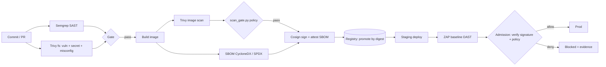

# RLogics Security Assessment - Candidate Repository

> **Lab-only repository.** Everything here targets purpose-built local lab systems. All credentials
> are synthetic. Nothing here should be pointed at systems you do not own.
>
> **AI assistance disclosure:** see [`docs/AI_DISCLOSURE.md`](docs/AI_DISCLOSURE.md).

## How to use this repo

1. Read [`GETTING_STARTED.md`](GETTING_STARTED.md) - ordered, time-boxed execution plan.
2. Run each exercise, capture your own evidence into `evidence/`.
3. Fill in the "Known limitations" section at the bottom of this file with what actually happened.
4. Before the interview, work through [`docs/INTERVIEW_PREP.md`](docs/INTERVIEW_PREP.md).

## Repository map

| Path | Exercise | What is in it |
|------|----------|---------------|
| `devsecops/` | 1 | Vulnerable lab app, remediated app, Semgrep/Trivy/ZAP/Cosign config, pipeline, decision table |
| `.github/workflows/` | 1 | GitHub Actions version of the pipeline |
| `openbao/` | 2 | OpenBao PKI lab, database dynamic-credential lab, concepts and production design |
| `scripts/` | 3 | `scan_gate.py` (Trivy JSON policy gate) with tests and sample inputs |
| `caldera/` | 4 | Research notes, benign operation plan, isolation and cleanup |
| `kubernetes/` | 5 | Unsafe review input (never deployed), hardened manifests, Kyverno policies, review notes |
| `architecture/` | 6 | Security implementation architecture document with diagrams |
| `ai-security/` | 7 | Tool comparison, five RAG/agent tests, Promptfoo example config |
| `evidence/` | all | Where your own run outputs go (see `evidence/README.md`) |

---

## Exercise 1 Part A - What DevSecOps means to me

DevSecOps is an operating model in which security is a property the delivery system produces
continuously, owned mainly by the people who change the system, with security specialists providing
guardrails, signal quality and an escalation path. It is not "add scanners to CI". A scanner that
nobody trusts or acts on is just latency.

**Who owns what.** Developers own their code, their dependency choices and fixing findings in their
repositories. The platform team owns the paved road: pipeline templates, hardened base images, the
registry, admission control, the secrets/PKI platform and the runtime baseline. The security team
owns policy-as-code, rule tuning, the exception and risk-acceptance process, threat modelling
support, independent validation (DAST, red team) and assurance evidence. Risk acceptance belongs to
the business/service owner, not to the security team and not to the developer who wants to ship.

**What happens at each stage.**
- *Commit:* pre-commit secret scanning, signed commits, branch protection, CODEOWNERS.
- *Pull request:* fast (<10 min) diff-aware SAST, SCA, secret and IaC/Kubernetes manifest scans.
  Findings appear as PR annotations. Only high-confidence, high-impact classes block.
- *Build:* reproducible build from a pinned base image, image scan, SBOM generation, signing and a
  provenance attestation by the pipeline identity (not a developer laptop).
- *Registry:* only the pipeline identity can push; immutable tags; promotion by digest; scheduled
  re-scans because new CVEs appear after build. **Scanned, signed and approved are three different
  states.**
- *Deployment:* admission control verifies signature, provenance and policy; DAST runs against a
  staging instance; runtime posture and drift checks continue afterwards.

**Finding vs gate vs exception.** A *finding* is an observation from a tool; it may be a false
positive and is not a decision. A *build gate* is an automated policy decision that turns findings
(plus context such as exposure and fix availability) into pass/fail at a specific stage. A *risk
exception* is a governance artefact: time-boxed, owned, approved by the right person, with
compensating controls and a review date. A suppression comment without those is not an exception.

**False positives, accepted risk and SLAs.** False positives are suppressed at the narrowest scope
(one rule, one line) with a reason and ticket, reviewed via CODEOWNERS, and tracked per rule so
noisy rules are tuned centrally instead of ignored. Accepted risk always expires (I would default to
30-90 days) and is re-approved, never open-ended. Remediation SLAs run from detection and depend on
severity *and* exposure, for example: known-exploited or critical on an internet-facing service in
days; high in about 30 days; medium in about 90; low as backlog. VEX statements record "not
affected / not reachable" so the same CVE is not re-triaged forever.

**Evidence retained.** Scan reports (SARIF/JSON) keyed by commit SHA and image digest, the SBOM,
signatures and attestations, pipeline run logs, the version of the policy that was applied, the
exception register with approvers, admission decisions and approvals. Stored immutably (WORM or
object-lock), retention per policy, and scrubbed of secrets and personal data.

---

## Exercise 1 Part B - Pipeline flow

The local equivalent is `devsecops/pipeline/run_pipeline.sh`. It deliberately **collects all
evidence first and then fails** if any stage failed, so one run gives you every finding instead of
stopping at the first one.

### Design decision table
See [`devsecops/policy/DECISION_TABLE.md`](devsecops/policy/DECISION_TABLE.md).

### Before/after remediation examples
See [`devsecops/FINDINGS_BEFORE_AFTER.md`](devsecops/FINDINGS_BEFORE_AFTER.md).

### Where results are exposed to developers
SARIF uploaded to GitHub code scanning (PR annotations), human-readable Markdown summary written to
the job summary, raw JSON/CycloneDX/HTML kept as build artifacts and copied to the evidence store.

---

## Known limitations / not completed

| Item | Status | Reason | Production approach |
|------|--------|--------|---------------------|
| Keyless Cosign signing | Local key-pair signing and verification tested; transparency log upload disabled | Local lab uses a private key and local registry | Use GitHub OIDC keyless signing, verify trusted identity and attestations, and enforce admission policies |
| Private registry | Local `registry:2` instance used | Lab-only setup | Use Harbor/ECR/ACR with immutability, RBAC, and scheduled rescanning |
| Active ZAP scan | Passive baseline scan passed; active scan not performed | Lab scope limited to baseline testing | Run an authenticated, rate-limited active scan against an explicitly authorized staging target |
| OpenBao database TLS | Database connection used `sslmode=disable` | Simplified local lab configuration | Require TLS with certificate and hostname verification |
| Kubernetes image registry trust | Hardened manifest scan retained one medium-severity finding | Registry trust still needs further review | Enforce approved registries, image provenance, signature verification, and controlled exceptions |
| Multi-region production architecture | Designed, not deployed or validated | Assessment ran in a local lab | Test regional isolation, failover, resilience, and evidence retention before production use |
| Caldera live operation | Research and benign operation plan completed; live execution not performed | Live execution was outside the completed lab scope | Execute only in an isolated, authorized environment with approval and cleanup |
| AI-security testing | Five local harness checks passed; no live LLM red-team testing performed | Promptfoo and Ollama were unavailable, and no live target was running | Run the tests against an authorized AI target and record findings and remediation |
| Kubernetes benchmark | `kube-bench` not run | Tool was not installed; no CIS benchmark result was produced | Run an appropriate benchmark against the target environment and document findings and exceptions |
| Kubernetes NetworkPolicy | Allow/deny connectivity checks passed in the local kind lab | Results apply to this local cluster, not a production CNI | Validate enforcement with the production CNI and workload environment |
| Repository secret scanning | Final repository-wide scan pending | Verification remains to be completed | Run a secret scanner, review findings, and resolve any confirmed issues before sharing |
