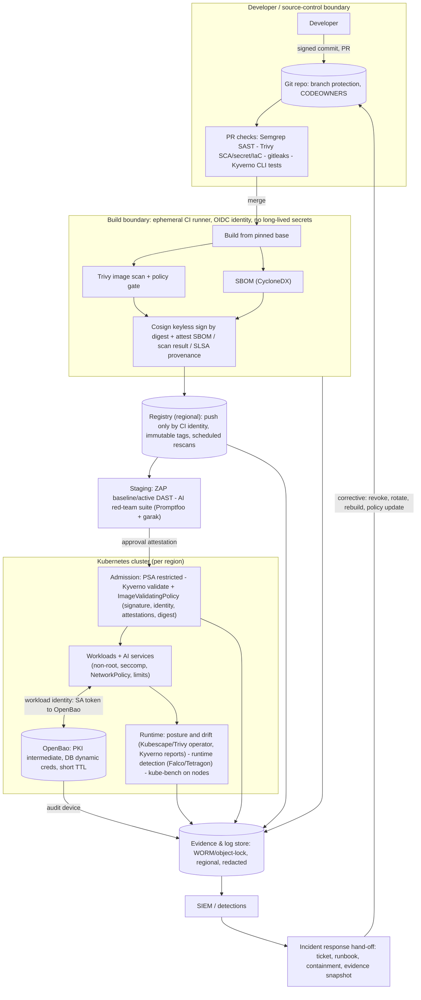

# Security Implementation Architecture - AI-enabled Kubernetes Platform

*Exercise 6. Open-source components throughout. Edit the "phasing" and "assumptions" to match your
own reasoning; the interviewers will probe the trade-offs, not the formatting.*

## 1. Scope and assumptions
Source repositories (GitHub) -> CI -> OCI registry -> Kubernetes clusters running business services
and **AI services** (RAG + tool-using agents calling internal APIs and models). Multiple
jurisdictions (e.g. EU/UK, US, APAC). Assumptions: GitHub Actions for CI; one registry per region;
OpenBao as the secrets/PKI platform; Kyverno for admission policy; central log/evidence store per
region. Unknowns I would resolve first: data classification, which regulators apply per region, and
the existing IdP/SIEM.

**Implementation status and scope:** This assessment demonstrates selected security controls in a local lab using a container-based pipeline, OpenBao, and Kubernetes. The lab validates scanning and policy gating, SBOM generation, image signing and verification, certificate issuance and revocation, short-lived database credentials, and Kubernetes admission controls. The multi-region architecture, GitHub Actions OIDC, keyless signing, signed approval attestations, production SIEM integration, and AI red-team automation are proposed production capabilities; they are not claimed as implemented by this lab.

## 2. Architecture diagram

## 3. Control mapping

| Stage | Controls | Type | When |
|-------|----------|------|------|
| Commit / PR | Signed commits, branch protection, CODEOWNERS, secret scan, SAST, SCA, IaC/K8s manifest scan, policy unit tests | Preventive (gate) + detective | Build time (fast, diff-aware) |
| Build | Hermetic/ephemeral runner, pinned bases, image scan, SBOM, keyless signing, provenance + scan attestations | Preventive + evidence | Build time |
| Registry | Push only by CI identity, immutable tags, promote **by digest**, scheduled re-scan, retention | Preventive + detective | Continuous |
| Pre-release | DAST on staging, AI red-team suite (OWASP LLM/Agentic tests), approval attestation | Detective -> gate | Release time |
| Admission | PSA restricted, Kyverno invariants, signature+identity+attestation verification, allowed registries, digest mutation | **Preventive (enforcement point)** | Admission time |
| Secrets/PKI | Workload identity -> OpenBao, per-app roles, 15m-1h certs, dynamic DB creds, audit device mandatory | Preventive | Runtime |
| Runtime | Posture/drift scans, runtime detection, NetworkPolicy flow review, CVE re-scan of running images, kube-bench | Detective | Runtime |
| Response | Revoke leases/certs, rotate keys, quarantine namespace, rebuild from source, policy update, post-incident review | **Corrective** | After detection |

**Scanned vs signed vs approved:** *scanned* = a tool looked and produced findings; *signed* = a
trusted identity vouches for the bytes (integrity + origin, not safety); *approved* = policy
evaluated the evidence (scan result, SBOM, tests, exceptions) and issued a signed **approval
attestation** that admission requires. Only approved artifacts run.

### 3.1 Lab validation and limitations

- **Pipeline gates:** The vulnerable pipeline was blocked by security checks. After remediation, all seven pipeline stages passed, including SAST, filesystem and image scanning, SBOM generation, DAST baseline scanning, and Cosign signing and verification.
- **Cosign:** The lab used key-based signing with transparency-log upload disabled. Registry communication required explicit HTTP-registry support. This validates the lab signing workflow but does not demonstrate production keyless signing or public transparency-log verification.
- **OpenBao PKI:** The certificate chain verified successfully. Attempts to issue a certificate for an unauthorized common name and access another application's role were denied. Certificate revocation was also exercised.
- **Database credentials:** Short-lived credentials supported read-only queries, rejected unauthorized writes, and were revoked or allowed to expire. The lab database connection used `sslmode=disable`; production deployment requires properly configured TLS verification.
- **Kubernetes:** Admission tests rejected privileged and root-running workloads as expected. The hardened-manifest Trivy scan still reported a medium-severity registry-trust finding that requires review.
- **Limitations:** These are local lab results, not evidence of production availability, multi-region resilience, complete regulatory compliance, or protection against every attack. Production rollout requires identity integration, secure key management, TLS, operational monitoring, and testing under the target environment's threat model.

## 4. Trust boundaries and compromise analysis

| Compromise | Blast radius | Prevent / limit | Detect / respond |
|-----------|--------------|-----------------|------------------|
| **Signing key** (key-based) | Attacker can sign malicious images that pass admission | Prefer **keyless** (no long-lived key; short-lived Fulcio cert bound to workflow identity, logged in Rekor); if keys: KMS/HSM, no export, rotation | Rekor/transparency monitoring for unexpected signatures; revoke trust by changing Kyverno attestor/identity; rebuild and re-sign; admission denies old signer |
| **CI identity** (OIDC subject / runner takeover) | Can produce validly signed, malicious images from the trusted workflow path | Narrow `subject` match (repo + workflow + ref), protected branches/environments, ephemeral runners, least-privilege `permissions`, required reviews on workflow files, provenance verifies *source commit* | Alert on workflow-file changes and signatures from unexpected refs; require provenance to match a reviewed commit; kill switch: tighten Kyverno identity |
| **Registry credential** | Push/pull images; can replace tags | Push only by CI identity; immutable tags; admission requires signature by digest so a swapped image fails; pull credentials read-only and per cluster | Registry audit logs, digest-change alerts, re-scan; rotate credentials |
| **OpenBao** | Secrets/cert issuance for whatever policy allows | Intermediate-only online, root offline, tight policies, mandatory audit, HA + auto-unseal | Alert on root-token use, policy changes, unusual issuance; revoke leases/intermediate; re-issue |
| **Prompt-injected AI agent** | Whatever its tools and identity allow | Least-privilege tools, user-delegated tokens, server-side authZ, egress controls, human approval for risky actions | Tool-call audit, anomaly alerts, scoped kill switch for the tool |

## 5. Secrets and PKI path
Workloads authenticate with projected, audience-bound service account tokens (Kubernetes auth /
JWT); each auth role is bound to namespace + service account and a minimal policy. They obtain
15-minute-to-1-hour leaf certificates from an environment-specific **intermediate** (root offline)
and per-app dynamic DB credentials (minutes to hours, read/write split). OpenBao outage: existing
leases continue until expiry, **new issuance fails closed**, apps retry with backoff, TTLs are sized
to outlast a realistic outage. CA and DB management keys never leave the secrets platform.

## 6. DAST and AI security testing
**DAST:** baseline on every staging deploy; authenticated active scans (with test accounts, agreed
windows, scope-locked) before major releases and on a schedule. **AI security:** Promptfoo suite
(app/agent-level: injection, leakage, tool abuse, ACL bypass) on prompt/tool/retrieval changes and
nightly; garak against the model/provider on model, system-prompt or guardrail changes; periodic
manual red team (PyRIT-style campaigns) feeding new automated tests. All against test deployments with
synthetic data; results versioned and trended.

## 7. Multi-jurisdiction considerations
- **Residency:** per-region clusters, registries, OpenBao, evidence stores; cross-region replication only for non-personal artifacts (images, SBOMs) unless approved. Region boundary enforced by network policy and IAM, and by admission (allowed regions/registries).
- **Data minimisation:** AI services get the least data needed; retrieval filtered by caller identity and region; no production personal data in test/red-team environments; prompts and responses are **sensitive logs**.
- **Privacy-sensitive logs:** redact/tokenise at source, field-level classification, separate "security evidence" from "content" logs, short retention for content, longer retention for control evidence, restricted access with break-glass and access auditing.
- **Access segregation:** platform vs security vs developers vs auditors with separate roles; no standing prod access; approvals recorded; regional admin boundaries.
- **Evidence retention:** WORM/object lock, retention per regulation and policy (control evidence usually 1-7 years vs content logs far shorter), legal-hold capability, deletion workflows for data-subject requests that do not destroy audit integrity.

## 8. Evidence for ISO/IEC 27001, ISO/IEC 42001, SOC 2 - without becoming audit-only
The controls *produce* evidence as a by-product of operating: signed attestations, admission
decisions, exception register, OpenBao audit logs, scan trends, AI test results per release,
change records (PRs). Map each control once to the three frameworks in a control library (e.g.
27001 Annex A for secure development/config/logging, 42001 for AI system lifecycle, risk, data and
testing, SOC 2 CC6/CC7/CC8) and let dashboards/exports pull from the same sources. Auditors sample
real evidence; engineers get the same data for operations. Avoid screenshot-driven compliance and
monthly evidence hunts.

## 9. First 90 days (what and why)
| Days | Phase | Why first |
|------|-------|-----------|
| 0-30 | PR checks (SAST/SCA/secrets) in **warn** mode, secret scanning **blocking**, SBOM generation, inventory of repos/clusters/registries, baseline metrics, exception process agreed | Visibility and trust before enforcement; stop the highest-impact leak (secrets) immediately |
| 31-60 | Registry hardening, keyless signing + attestations from CI, Kyverno + PSA in **audit**, then enforce for privileged/hostPath/root; start OpenBao for dynamic DB creds on 1-2 services | Integrity chain starts; low-risk enforcement of clear-cut invariants |
| 61-90 | After end-to-end validation, enforce signature/attestation verification for production namespaces; integrate DAST in staging; pilot Promptfoo/garak for the first AI service; add runtime posture/detection and evidence-store integration | Enforce only after trusted identities, verification rules, exceptions, and recovery procedures are tested; begin AI assurance on the most exposed service |
Rationale: **measure -> warn -> enforce**, start with controls that are high-impact and low-friction,
and never enforce a gate before there is a documented remediation path or process for requesting an exception.
